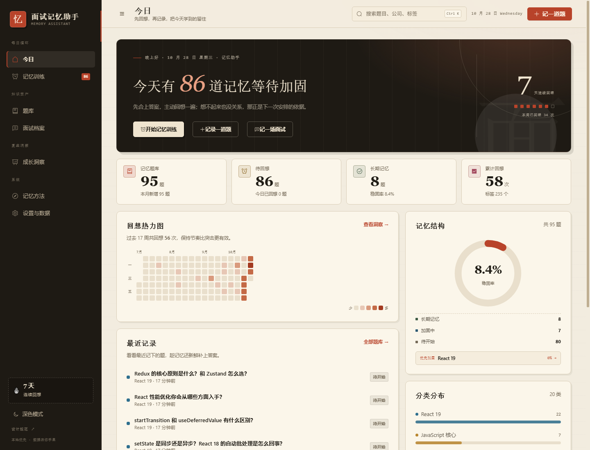
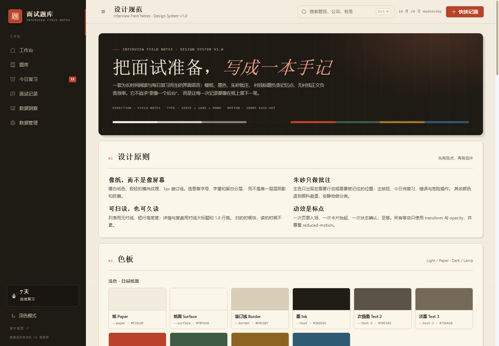
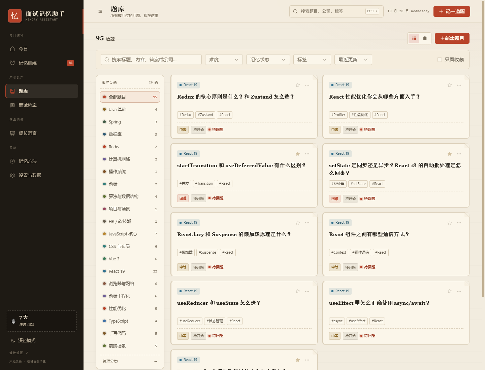
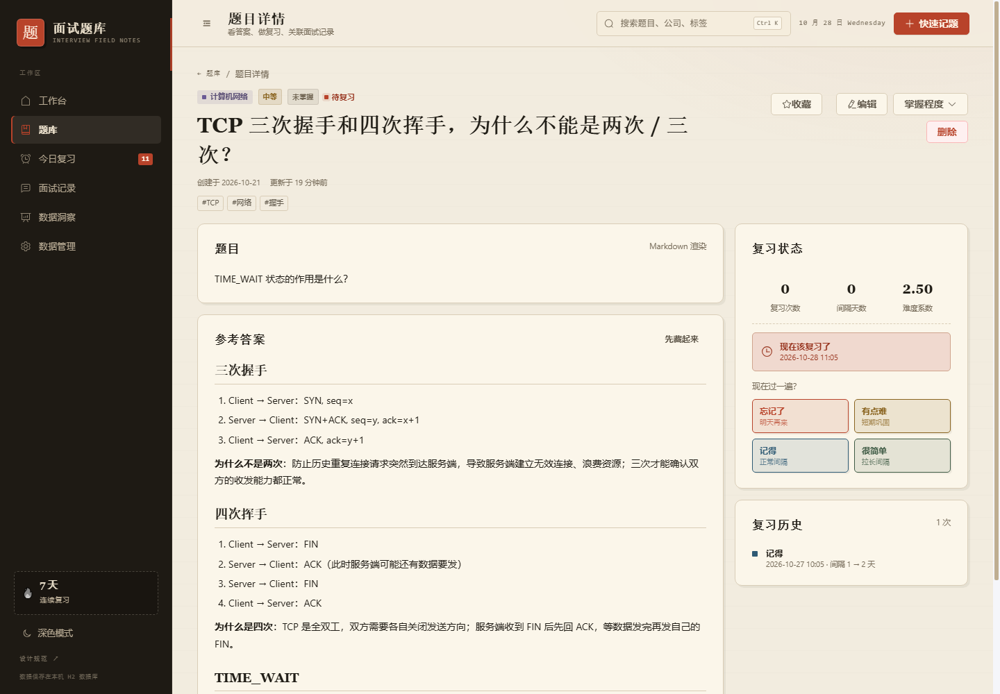
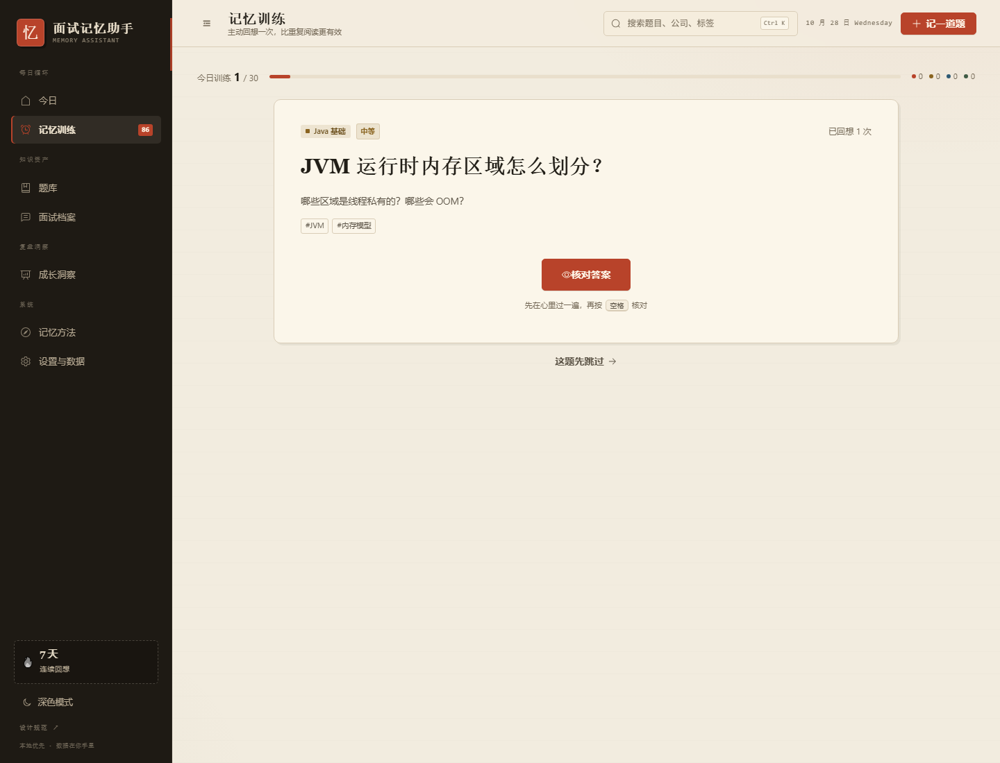
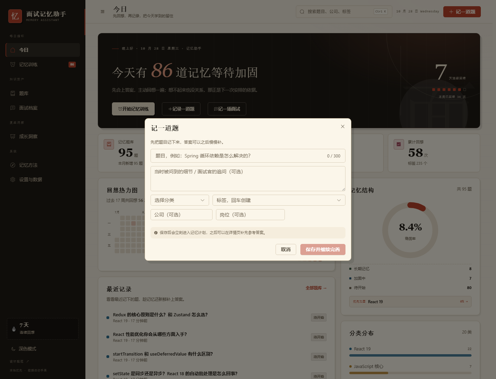
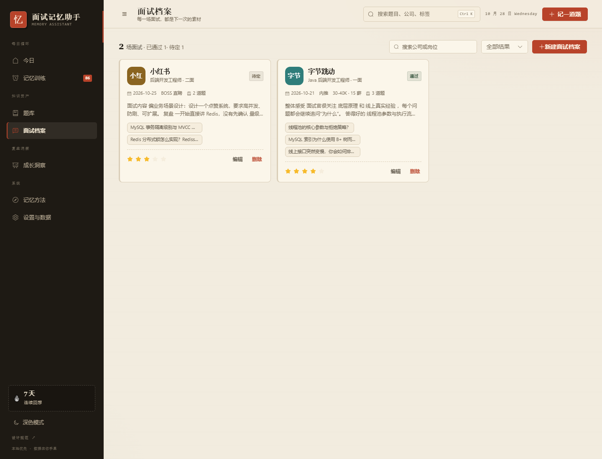
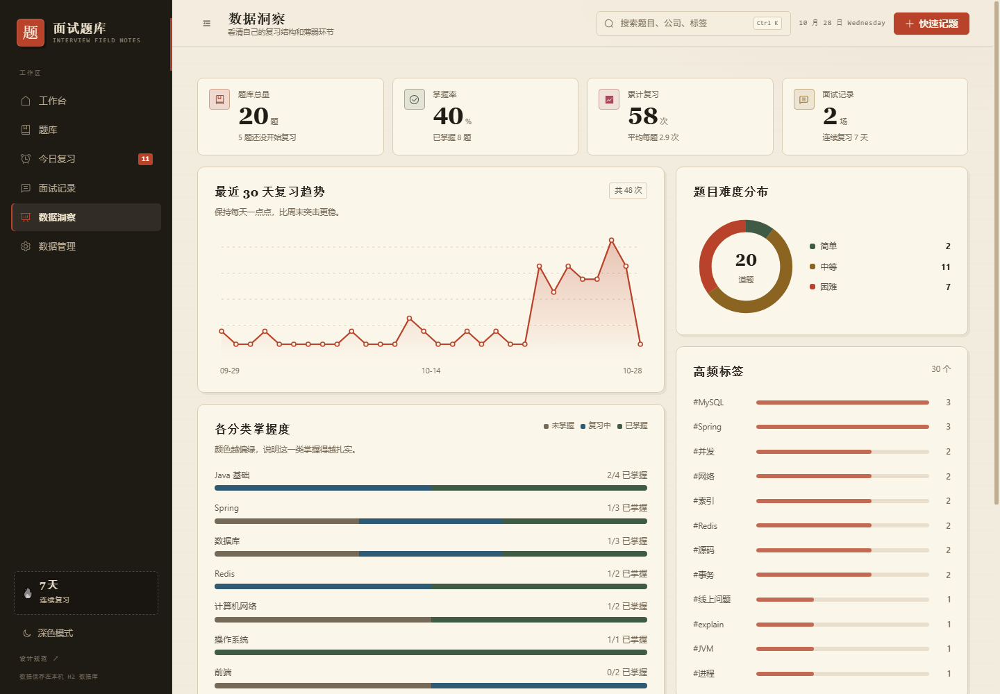
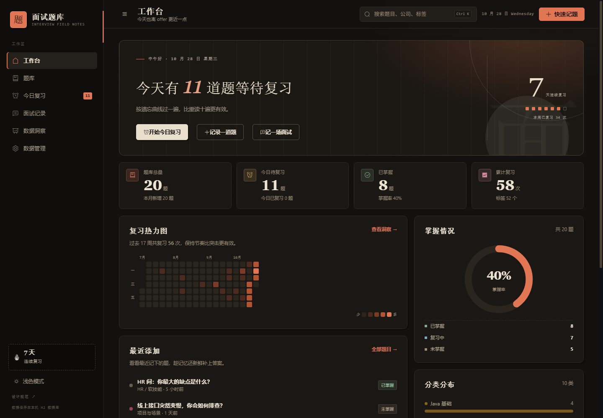

# 面试题库 · 面试手记

一个给自己用的面试题记录 + 间隔复习 + 面试复盘工具。前端 Vue 3、后端 Spring Boot、数据库 MySQL，三部分可以独立构建和部署；也保留 H2 单机模式，解压即用，不依赖任何第三方服务。

[](https://github.com/zhouduoyin/interview-bank/actions/workflows/web-ci.yml)

> 第一次运行、分不清前端 / 后端 / 数据库？先看 **[START-HERE.txt](START-HERE.txt)**。  
> 最简启动：双击 `start.bat`，浏览器打开 <http://127.0.0.1:8090>。

## 先认识三个部分

| 你看到的目录 | 是什么 | 最简模式要不要单独启动 |
| --- | --- | --- |
| `web/` | 前端，Vue 3 + Vite，放页面、组件、样式 | 不用。前端已经打包进 jar |
| `server/` | 后端，Spring Boot + Java，放 API 和业务逻辑 | 不用手动启动，`start.bat` 会启动 jar |
| `data/` | 默认数据库 H2，就是一个本地文件 | 不用安装，也不用单独启动 |
| `sql/init.sql` | 可选 MySQL 的建库脚本，不是数据库程序 | 只有切 MySQL 时才用 |

关键点：`server/target/interview-bank.jar` 是**已经打包好的最终程序**，里面包含前端页面。  
所以日常使用只需要双击 `start.bat`，不用开前端、后端、数据库三个窗口。

> 记录每一道被问到的题，写下自己的答案，在忘记之前复习它。

界面采用「暖纸 · 墨色 · 朱砂」的**面试手记**视觉体系：像一本摊在桌上的工作笔记，而不是又一个蓝紫渐变后台。完整设计规范见 [docs/design-system.md](docs/design-system.md)，启动后也可以访问 `/styleguide` 查看活文档。



## 功能

- **题库管理**：新建 / 编辑 / 删除题目，支持 Markdown 书写题目描述与参考答案（代码高亮、表格、引用），支持分类、难度、标签、来源公司 / 岗位、收藏。
- **快速记录**：新建题目只显示「问题 + 答案」两个输入框，分类、标签等高级信息可在编辑页补充。
- **分类导航**：题库左侧分类栏显示每个分类的题目数量，点击即可切换分类题库，分类会同步到 URL，方便刷新和分享。
- **快速记题**：任意页面 `Ctrl + N` 呼出快速记录框，先记下题目，之后再补答案。
- **间隔复习**：内置 SM-2 简化版算法，根据「忘记 / 有点难 / 记得 / 很简单」自动安排下次复习时间；今日复习页提供翻卡式自测，支持键盘操作。
- **题目详情**：参考答案可折叠，复习历史时间线，掌握程度快捷调整，展示这道题出现在哪些面试里。
- **面试记录**：按场次记录公司、岗位、轮次、日期、渠道、薪资、结果、自评与复盘，可关联题库中的题目，写下面试官追问和自己的回答。
- **数据洞察**：复习热力图、30 天趋势、分类掌握度、难度分布、高频标签、薄弱分类提醒、连续复习天数。
- **数据管理**：JSON 一键导出 / 导入（按标题去重合并）、Markdown 导出、分类与标签管理、清除示例数据、清空全部数据。
- **体验细节**：亮 / 暗色主题、侧栏折叠、全局搜索（`Ctrl + K`）、列表卡片 / 表格两种视图、批量操作、分页、空状态引导、响应式布局。

## 内置前端 2026 题库

仓库里的 [`docs/frontend-2026-question-bank.json`](docs/frontend-2026-question-bank.json) 是一份按 2025–2026 前端面试常见方向整理的可导入题库，共 **75 道题、10 个新分类**（另有 3 道算法题归入现有的「算法与数据结构」分类）：

- JavaScript 核心、CSS 与布局、Vue 3、React 19
- 浏览器与网络、前端工程化、性能优化、TypeScript
- 手写代码、前端场景（权限、上传、主题、监控、AI 流式）

题目覆盖闭包、事件循环、Vue 编译优化、React 19 Actions / `use` / RSC、JSX / key / 受控组件 / Hooks 闭包陷阱 / setState 批处理 / Transition、HTTP 缓存与 HTTP/3、Core Web Vitals 的 INP、Vite、Tree Shaking、Monorepo、容器查询、`satisfies`、防抖节流、Promise.all、LRU 等高频考点。答案按面试口述的深度编写，不是一句话结论。

React 部分参考了掘金文章 [《2026 最新 React 面试题》](https://juejin.cn/post/7348651815759282226) 的题目方向，答案按本仓库的面试口述风格重新整理。

本地已经导入时无需重复操作；新环境可以在应用启动后导入：

```powershell
$body = Get-Content -Raw -Encoding UTF8 .\docs\frontend-2026-question-bank.json
Invoke-RestMethod -Method Post `
  -Uri 'http://127.0.0.1:8090/api/data/import' `
  -ContentType 'application/json; charset=utf-8' `
  -Body ([Text.Encoding]::UTF8.GetBytes($body))
```

导入按题目标题去重，重复执行不会产生重复题目；分类不存在时会自动创建。

## 设计：把面试准备写成一本手记

这套界面不是套模板，而是先定了概念，再落成一套可复用的设计系统。

- **纸先于屏**：暖纸底色、1px 细线、3px 硬阴影，容器先是「纸片」再是「卡片」。
- **墨分五色，只用一个强调色**：正文用墨，真正的重点用朱砂；苔绿 / 赭石 / 石青只做分类与状态。
- **衬线负责记忆，无衬线负责效率**：标题、数字用衬线；正文、表单用无衬线；日期、编号、标签用等宽。
- **动效是纸的惯性**：只动 `transform / opacity`，120 / 180 / 260ms，尊重 `prefers-reduced-motion`。

亮暗双主题共用一套 CSS 变量，Element Plus 也映射到同一套 token；分类色通过 `color-mix` 随主题自适应。设计规范页包含色板、字号、间距、组件、动效与可访问性清单。



- 活文档：<http://127.0.0.1:8090/styleguide>
- 完整规范：[docs/design-system.md](docs/design-system.md)

## 界面预览

### 题库

卡片 / 表格双视图，支持关键词、分类、难度、掌握度、标签、收藏筛选。



### 题目详情

Markdown 渲染的题目与答案、复习状态、历史记录、关联面试。



### 今日复习

先自己想，再翻答案，然后用四个按钮决定下次什么时候再见。



### 快速记题

`Ctrl + N` 随时记录，先把题留住，答案可以稍后补。



### 面试记录

一场面试一条记录，关联被问到的题目，复盘时能串起来看。



### 数据洞察

复习趋势、分类掌握度、难度分布、高频标签和需要加强的方向。



### 暗色主题



## 快速开始

### 方式一：H2 零配置（最快体验）

本地这份目录已经包含构建好的 `server/target/interview-bank.jar`，**无需安装数据库、无需联网**即可运行。

双击 `start.bat`（推荐），或在项目根目录执行：

```powershell
java -jar server\target\interview-bank.jar
```

浏览器访问 <http://127.0.0.1:8090>。首次启动会自动建库并写入 20 道示例题、10 个分类、2 条面试记录；数据保存在 `data/` 的 H2 文件中。

停止：关闭运行窗口，或在项目根目录执行 `.\stop.ps1`。

### 方式二：MySQL + 前后端分离（正式使用）

这是标准的 Spring Boot + Vue + MySQL 三端结构：

```text
Vue 3（Nginx / Vite :5173） --/api--> Spring Boot（:8090） --JDBC--> MySQL（:3306）
```

1. 初始化数据库（本机 MySQL 需先启动）：

```powershell
mysql -u root -p -e "source sql/init.sql"
```

2. 构建并启动后端：

```powershell
cd server
mvn -DskipTests package
cd ..
.\start-mysql.bat
```

3. 另开一个终端启动前端：

```powershell
cd web
npm ci
npm run dev
```

打开 <http://127.0.0.1:5173>。Vite 会把 `/api` 代理到 `http://127.0.0.1:8090`。

完整说明（账号、环境变量、表结构、H2 数据迁移、Nginx 配置）见 **[docs/mysql.md](docs/mysql.md)**。

### 方式三：Docker Compose 一键三端

根目录的 `docker-compose.yml` 会同时启动 MySQL、Spring Boot 与 Nginx：

```powershell
docker compose up -d --build
```

- 前端：<http://127.0.0.1:18090>
- 后端 API：<http://127.0.0.1:18089/api/stats/dashboard>
- MySQL：`127.0.0.1:13307`，库 `interview_bank`，用户 `interview / interview_pass`

端口和密码可通过根目录 `.env` 覆盖（参考 `.env.example`）。停止：`docker compose down`。

### 从 GitHub 克隆（只有源码）

仓库按常规忽略 `node_modules/`、`web/dist/` 与 `server/target/`。H2 单机模式第一次需要自行构建：

```powershell
cd web
npm ci
cd ..
.\build.ps1
java -jar server\target\interview-bank.jar
```

构建需要 JDK 17+、Maven 与 Node.js 22.13+，并保持网络可用以下载 Maven / npm 依赖。

### 环境要求

- JDK 17 及以上（开发时使用 JDK 21 运行）
- MySQL 8.0+ 或 Docker（仅 MySQL / 分离模式需要）
- Node.js 22.13+（推荐 24 LTS）与 Maven（重新构建前端 / 后端时需要）

### 端口

默认后端使用 `8090`，前端开发服务器使用 `5173`。端口被占用时可以换：

```powershell
$env:SERVER_PORT=8091; java -jar server\target\interview-bank.jar
```

## 开发模式

后端（Spring Boot，默认 H2，端口 8090）：

```powershell
cd server
mvn spring-boot:run
```

后端使用 MySQL：

```powershell
cd server
$env:SPRING_PROFILES_ACTIVE='mysql'
$env:DB_URL='jdbc:mysql://127.0.0.1:3306/interview_bank?useUnicode=true&characterEncoding=utf8&useSSL=false&allowPublicKeyRetrieval=true&serverTimezone=UTC'
$env:DB_USERNAME='interview'
$env:DB_PASSWORD='interview_pass'
mvn spring-boot:run
```

前端（Vite，端口 5173，`/api` 自动代理到 8090）：

```powershell
cd web
npm run dev
```

打开 <http://127.0.0.1:5173>。

### 前端工程化

`web/` 是一个标准 Vite 工程，已包含 ESLint、Prettier、Vitest 与 GitHub Actions：

```powershell
cd web
npm ci              # 按 package-lock.json 安装，CI / Docker 同样使用
npm run dev         # 开发服务器，默认 5173
npm run lint        # ESLint flat config
npm run format:check
npm run test        # Vitest + jsdom
npm run build       # 产物在 web/dist
npm run preview     # 预览生产构建
```

- 环境变量：`.env.development` / `.env.production` 提供默认值，个人配置写 `.env.local`（不提交）
- Vite 配置：`vite.config.js`，支持 `VITE_DEV_PORT`、`VITE_PROXY_TARGET`、`VITE_PUBLIC_BASE`
- 路径别名：`@` → `src/`，IDE 使用 `jsconfig.json`
- 代码规范：`eslint.config.js`、`.prettierrc.json`、`.editorconfig`
- CI：`.github/workflows/web-ci.yml` 执行 `npm ci` → lint → test → build

> 更新依赖后，建议在 Linux / WSL 中重新生成 `package-lock.json`。Windows 上生成的 lockfile 可能缺少 Rolldown、Lightning CSS 的 Linux 可选依赖，导致 CI / Docker 的 `npm ci` 报 `EUSAGE`。

### 重新构建

单 jar（H2 演示 / 最简单）仍然使用：

```powershell
.\build.ps1
```

脚本会依次执行：前端 `npm run build` → 把 `web/dist` 复制进后端 `src/main/resources/static` → `mvn -DskipTests package`，最终产物为 `server/target/interview-bank.jar`（前端已打进 jar，单文件即可运行）。

前后端分离部署时，两边分别构建即可：

```powershell
# 后端
cd server
mvn -DskipTests package

# 前端，产物在 web/dist，交给 Nginx
cd web
npm run build
```

## 快捷键

| 快捷键 | 位置 | 作用 |
| --- | --- | --- |
| `Ctrl / ⌘ + K` | 全局 | 聚焦顶栏搜索 |
| `Ctrl / ⌘ + N` | 全局 | 快速记一道题 |
| `Ctrl / ⌘ + S` | 题目 / 面试编辑页 | 保存 |
| `空格` / `Enter` | 今日复习 | 显示答案 |
| `1` `2` `3` `4` | 今日复习 | 忘记 / 有点难 / 记得 / 很简单 |

## 复习算法

采用 SM-2 的简化版本，只保留对个人复习最有用的部分：

| 评价 | 下次间隔 | 难度系数 ease |
| --- | --- | --- |
| 忘记了 | +1 天 | −0.25（最低 1.3） |
| 有点难 | 上次间隔 × 1.2 | 不变 |
| 记得 | 上次间隔 × ease | 不变 |
| 很简单 | 上次间隔 × ease × 1.3 | +0.1（最高 3.2） |

间隔限制在 1–365 天。复习次数达到 3 次或下次间隔 ≥ 7 天时，题目自动标记为「已掌握」。

## 数据说明

- **H2 模式**（默认）：数据保存在运行目录下的 `data/` 文件夹（`interview-bank.mv.db`），单机单用户，无登录。
- **MySQL 模式**：数据保存在 `interview_bank` 数据库，连接信息由 `DB_URL / DB_USERNAME / DB_PASSWORD` 控制；空库首次启动会自动建表并写入示例数据。
- 备份：H2 直接复制 `data/` 文件夹；MySQL 使用 `mysqldump`，或在「数据管理」里导出 JSON。
- 恢复 / 迁移：把 JSON 导入即可；导入按标题去重，不会覆盖已有题目。H2 → MySQL 的迁移步骤见 [docs/mysql.md](docs/mysql.md)。
- 重置：H2 停止服务后删除 `data/`；MySQL 删除 `interview_bank` 库后重新创建。
- 清空全部：在「数据管理」里输入「清空」确认，会删除题目、分类、标签、面试记录与复习历史。

## 技术栈

- 后端：Spring Boot 3.5、Spring Web、Spring Data JPA、Bean Validation、Lombok
- 数据库：MySQL 8（`mysql` profile）/ H2（`h2` profile，零配置演示）
- 前端：Vue 3、Vue Router 4、Element Plus、Vite、marked + DOMPurify + highlight.js、dayjs
- 部署：Vite 开发代理 / Nginx 反向代理 / Docker Compose 三端编排
- 样式：设计令牌 + 原生 CSS；亮 / 暗双主题；Element Plus 变量映射；无第三方 UI 模板依赖

## 目录结构

```
interview-bank/
├─ server/                       Spring Boot 后端（独立 API）
│  ├─ src/main/java/com/interviewbank/
│  │  ├─ domain/                 实体与枚举
│  │  ├─ repo/                   JPA Repository
│  │  ├─ service/                业务逻辑、示例数据、统计
│  │  ├─ web/                    REST Controller 与 SPA 转发
│  │  └─ common/                 统一返回、异常处理
│  ├─ src/main/resources/
│  │  ├─ application.yml         公共配置，默认 h2 profile
│  │  ├─ application-h2.yml      H2 文件数据库
│  │  ├─ application-mysql.yml   MySQL 数据源
│  │  └─ static/                 单 jar 模式下的前端静态资源
│  ├─ Dockerfile                 Maven 构建 + JRE 运行
│  └─ target/interview-bank.jar  可直接运行的产物
├─ web/                          Vue 3 前端（独立 SPA）
│  ├─ src/
│  │  ├─ views/                  工作台、题库、复习、面试、洞察、数据、设计规范
│  │  ├─ components/             Markdown 编辑器 / 阅读器、热力图等
│  │  ├─ layout/                 侧栏与顶栏
│  │  ├─ store/                  轻量全局状态
│  │  └─ styles/
│  │     ├─ tokens.css           设计 token（颜色、字体、间距、动效、EP 变量）
│  │     ├─ main.css             结构、布局与组件骨架
│  │     └─ theme.css            视觉层（纸感、墨色侧栏、组件外观、响应式）
│  ├─ nginx.conf                 生产环境 SPA + /api 反向代理
│  ├─ Dockerfile                 Node 构建 + Nginx 运行
│  └─ dist/                      构建产物
├─ sql/init.sql                  创建 MySQL 库与开发用户
├─ docs/
│  ├─ design-system.md           完整设计规范
│  ├─ mysql.md                   MySQL 与三端分离部署说明
│  └─ screenshots/               界面截图
├─ docker-compose.yml            MySQL + Spring Boot + Nginx 编排
├─ start.bat / start.ps1         H2 单机一键启动
├─ start-mysql.bat / .ps1        MySQL 模式启动后端
├─ stop.ps1                      停止服务
├─ build.ps1                     单 jar 一键构建
└─ data/                         H2 运行后生成的本地数据库（不提交）
```

## 主要接口

| 方法 | 路径 | 说明 |
| --- | --- | --- |
| GET | `/api/stats/dashboard` | 工作台统计 |
| GET | `/api/stats/insights` | 数据洞察 |
| GET / POST | `/api/questions` | 题目列表（关键词、分类、难度、掌握度、标签、收藏、排序、分页）/ 新建 |
| GET / PUT / DELETE | `/api/questions/{id}` | 题目详情 / 更新 / 删除 |
| PATCH | `/api/questions/{id}/star` | 切换收藏 |
| PATCH | `/api/questions/{id}/mastery?value=` | 修改掌握程度 |
| POST | `/api/questions/{id}/review` | 提交一次复习评价 |
| GET | `/api/questions/{id}/reviews` | 复习历史 |
| GET | `/api/review/queue?limit=` | 今日复习队列 |
| GET / POST | `/api/interviews` | 面试列表 / 新建 |
| GET / PUT / DELETE | `/api/interviews/{id}` | 面试详情 / 更新 / 删除 |
| GET | `/api/data/export` | 导出 JSON |
| GET | `/api/data/export/markdown` | 导出 Markdown |
| POST | `/api/data/import` | 导入 JSON |
| DELETE | `/api/data/demo` | 清除示例数据 |
| DELETE | `/api/data/all` | 清空全部数据 |

## 常见问题

**启动后浏览器提示无法连接？**  
首次启动需要初始化数据库，约 20 秒；`start.ps1` 会等接口就绪后再打开浏览器。若手动启动，请看到 `Started InterviewBankApplication` 后再访问。

**MySQL 模式启动报 `Communications link failure`？**  
说明 Spring Boot 连不上 MySQL。确认 MySQL 已启动、`interview_bank` 库已创建、账号密码与 `DB_URL / DB_USERNAME / DB_PASSWORD` 一致；Docker 模式要等 `mysql` 健康检查通过后再启动后端。

**MySQL 模式前端接口 404？**  
后端在 `mysql` profile 下只提供 `/api/**`，不再托管前端；请通过 Vite（5173）或 Nginx 访问前端，不要直接打开 8090。

**8090 端口被占用？**  
用 `stop.ps1` 检查并停止旧实例，或通过 `SERVER_PORT` 换端口。

**想把自己的数据带到另一台电脑？**  
在「数据管理」导出 JSON，把文件拷过去后导入即可。H2 也可以直接复制 `data/` 文件夹；MySQL 建议用 JSON 或 `mysqldump`。

**示例数据会一直存在吗？**  
只在第一次启动时写入一次。点击「清除示例数据」后不会再自动生成，除非删掉整个 `data/` 目录或 MySQL 库重新开始；初始化标记保存在数据库的 `app_meta` 表中，H2 与 MySQL 互不影响。
