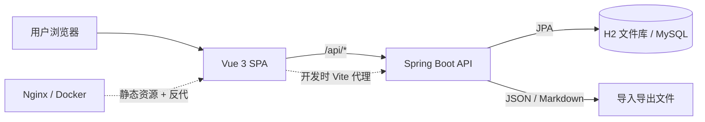
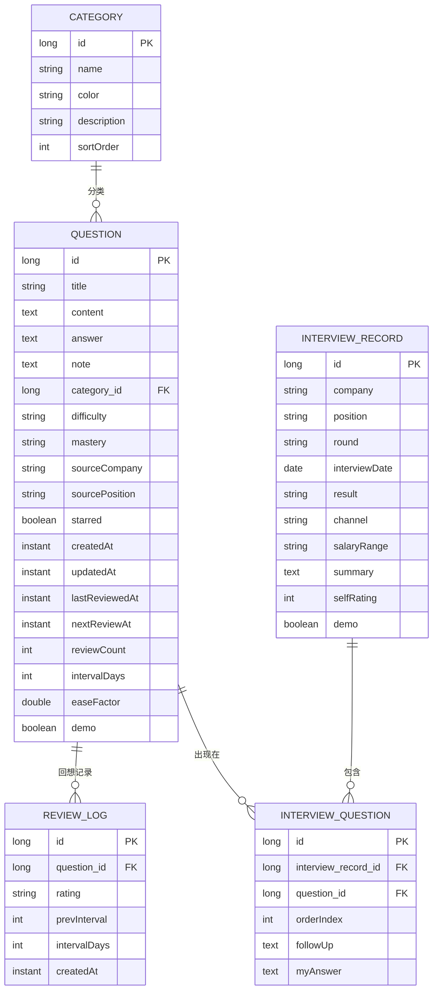
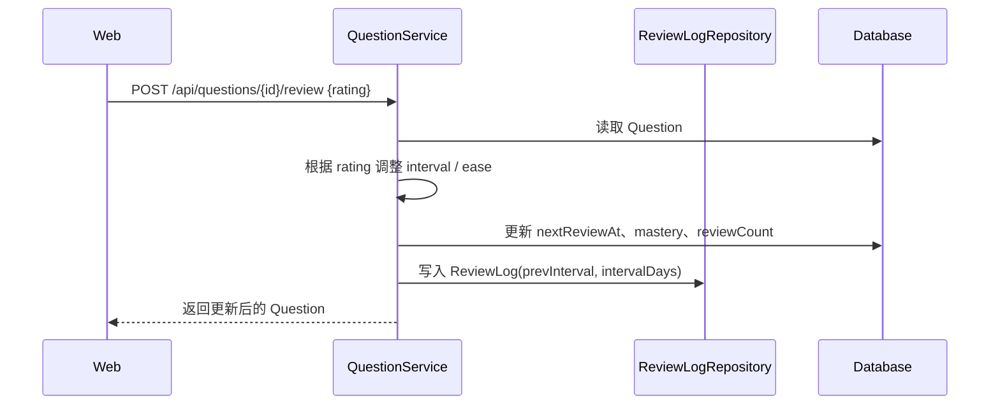
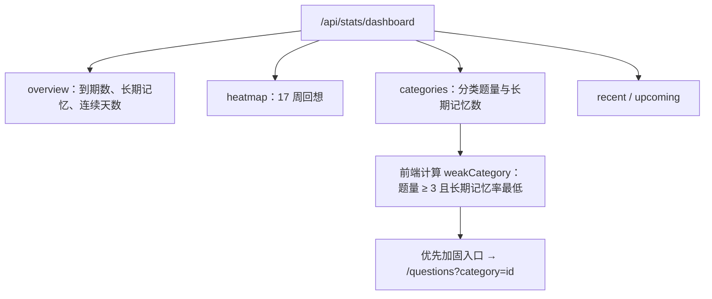

# 面试记忆助手 · 系统架构

> 产品名是「面试记忆助手」，代码里的 `interview-bank` 是历史代号。为了保证已有数据库文件、启动脚本、CI 和 Git 历史继续可用，**内部包名、jar 名、H2 文件名暂不改名**；对外展示统一使用产品名。

## 1. 系统上下文



两种运行形态：

| 形态 | 前端 | 后端 | 数据库 | 适用场景 |
| --- | --- | --- | --- | --- |
| 单 jar（默认） | 打包进 jar 的 `static/` | 同一个 Spring Boot 进程 | H2 文件 | 本地日常使用、零配置 |
| 分离部署 | Nginx / Vite | Spring Boot | MySQL 8 | 正式使用、多设备、Docker |

## 2. 分层与模块

### 2.1 前端 `web/`

```text
views/        页面级编排：今日、题库、训练、面试、洞察、方法、设置
components/   可复用 UI：Markdown、热力图、快速记题、空状态
layout/       应用外壳：侧栏、顶栏、全局搜索、快捷键
config/       品牌与导航信息架构（单一事实来源）
router/       路由表与页面标题
store/        轻量全局状态：主题、侧栏、分类、标签、到期数
api/          唯一请求入口，统一错误提示
utils/        字典、格式化、Markdown 渲染
styles/       tokens → main → theme 三层样式
```

约束：

- 页面不直接写 `fetch`，统一走 `api/`；
- 品牌名、导航项不散落在组件里，统一从 `config/` 读取；
- 设计 token 只在 `tokens.css` 定义，页面用变量，不硬编码色值；
- 路由路径保持稳定，信息架构升级不破坏书签和已有链接。

### 2.2 后端 `server/`

```text
web/          REST Controller、SPA 转发、统一响应
service/      业务事务：题目、回想、面试、分类、标签、统计、导入导出
repo/         Spring Data JPA Repository
domain/       实体与枚举（Question、Category、ReviewLog、InterviewRecord…）
request/      请求 DTO 与校验
common/       分页结果、业务异常、全局异常处理
config/       Web 配置（SPA fallback、跨域等）
```

依赖方向固定为 `web → service → repo → domain`。Controller 不写业务逻辑，Service 不感知 HTTP，Repository 不承载业务规则。

## 3. 数据模型



题目与标签是多对多（`question_tags` 元素集合）；题目与面试是带“追问 / 我的回答 / 顺序”的关联实体，不是简单多对多。

## 4. 回想算法

实现位置：`QuestionService.review()`。



| 评分 | 下一次间隔 | ease 变化 | 记忆状态 |
| --- | --- | --- | --- |
| 忘记 | 1 天 | −0.25，最低 1.3 | 加固中 |
| 有点难 | 上次 × 1.2（至少 1 天） | −0.15，最低 1.3 | 保持 / 加固中 |
| 记得 | 上次 × ease | 不变 | 间隔 ≥ 7 天或累计 3 次 → 长期记忆 |
| 很简单 | 上次 × ease × 1.3 | +0.15，最高 3.2 | 长期记忆 |

间隔最终限制在 1–365 天。算法是 SM-2 的简化版本，目标不是“学术准确”，而是让个人记忆节奏可持续。

## 5. API 地图

| 领域 | 主要端点 | 说明 |
| --- | --- | --- |
| 题目 | `GET/POST /api/questions`、`GET/PUT/DELETE /api/questions/{id}` | 搜索、分页、增删改查 |
| 题目状态 | `PATCH /api/questions/{id}/star`、`PATCH /api/questions/{id}/mastery` | 收藏、手动调整记忆状态 |
| 回想 | `POST /api/questions/{id}/review`、`GET /api/questions/{id}/reviews` | 评分、回想历史 |
| 训练队列 | `GET /api/review/queue` | 到期题目、到期数、新题数 |
| 批量 | `POST /api/questions/batch` | 删除、改状态 |
| 面试 | `GET/POST /api/interviews`、`GET/PUT/DELETE /api/interviews/{id}` | 面试档案 CRUD |
| 关联 | `POST/DELETE /api/interviews/{id}/questions` | 面试与题目关联 |
| 分类 / 标签 | `/api/categories`、`/api/tags` | 管理分类、重命名标签 |
| 统计 | `GET /api/stats/dashboard`、`GET /api/stats/insights` | 今日、热力图、趋势、分类结构 |
| 数据 | `/api/data/export`、`/api/data/export/markdown`、`POST /api/data/import` | 备份、迁移、按标题去重 |
| 危险操作 | `DELETE /api/data/demo`、`DELETE /api/data/all` | 清示例、清空全部 |

统一错误由 `GlobalExceptionHandler` 转换为可读消息；前端 `api/` 层集中提示，页面只处理成功态。

## 6. 今日页数据流



`weakCategory` 在前端计算，避免为单一展示需求新增后端接口；如果后续要做周报 / 推送，再下移到 `StatsService`。

## 7. 数据安全与迁移

- **默认 H2**：`data/interview-bank.mv.db`，数据在本地；不要删除，除非确认要重置。
- **MySQL**：连接信息由 `DB_URL / DB_USERNAME / DB_PASSWORD` 控制。
- **导入**：按题目标题去重，已存在题目跳过；分类不存在时自动创建。
- **导出**：JSON 为全量备份；Markdown 适合放进笔记软件。
- **危险操作**：清示例数据只删 `demo=true`；清空全部需要输入确认词。
- **改名兼容**：产品改名不改变 jar 名、数据库文件名和包名，已有数据与脚本不受影响。

## 8. 关键设计决策

| 决策 | 选择 | 原因 |
| --- | --- | --- |
| 单用户还是多用户 | 单用户、本地优先 | 降低复杂度，数据自持；多用户会引入认证、租户隔离和权限 |
| 回想算法 | SM-2 简化版 | 可解释、可手算、足够个人使用 |
| 题库与面试关系 | 关联实体 | 需要记录追问、我的回答和顺序，不能只存 ID 列表 |
| 前端状态 | 轻量 reactive store + 页面局部状态 | 当前规模不需要 Pinia / Vuex；避免为小项目引入大依赖 |
| 信息架构 | 保留路由，重命名导航 | 已有书签、历史、分享链接不失效 |
| 品牌改名 | 只改展示层 | 避免数据库文件、jar、CI、部署脚本连锁迁移 |
| 导入策略 | 标题去重、不覆盖 | 防止误导入覆盖手写答案 |

## 9. 扩展点

- **新增页面**：在 `views/` 建页面 → `router/` 加路由 → `config/navigation.js` 加导航（如果需要一级入口）。
- **新增统计**：优先在 `StatsService` 聚合，Controller 只做参数校验；前端不要重复计算可复用指标。
- **新增回想维度**：在 `Rating` 与 `QuestionService.review()` 扩展，同时补 `ReviewLog` 字段和迁移脚本。
- **接入 AI**：作为独立 `service` 适配器，默认关闭；AI 输出只能作为“复盘提示”，不覆盖用户答案。
- **多用户**：需要新增用户实体、认证、数据归属与迁移；当前架构不预留伪多租户字段。

## 10. 质量门禁

```powershell
cd web
npm run verify   # ESLint + Prettier + Vitest + Vite build
```

后端：

```powershell
cd server
mvn -DskipTests package
```

发版前额外检查：

- 首页、题库、训练、面试、洞察、方法、数据页可打开；
- 新增题库导入后总数与分类数正确；
- 训练评分后 `nextReviewAt`、`mastery`、`ReviewLog` 一致；
- 亮 / 暗主题、窄屏表格、键盘快捷键无回归；
- 不删除 `data/`，不执行 `DELETE /api/data/all`。
